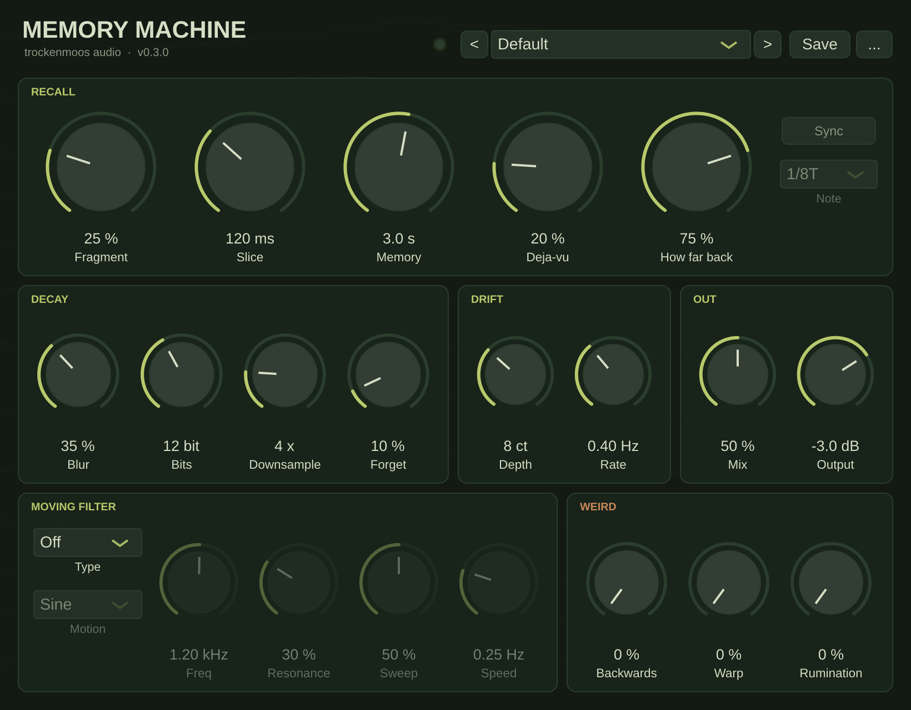

# Memory Machine — memory-decay effect (VST3 / AU / LV2) · v0.3.0

An audio effect modelled on how memory fails. The sound blurs and loses
resolution, the pitch drifts like old tape, moments drop out, and fragments of
the recent past come back. Sometimes they come from the wrong place: that's
déjà-vu.



Part of the trockenmoos audio series — <https://www.trockenmoos.com/plugins/>

## Controls

| Section | Control | What it does |
|---|---|---|
| **Recall** | Fragment | How often a slice of the recent past is replayed (1–4 repeats) |
| | Slice / Sync + Note | Slice length, free in ms or tempo-synced (1/1 … 1/32, dotted, triplets) |
| | Memory | How far back recall can reach (0.25–8 s) |
| | Déjà-vu | Chance that a recall comes from further back instead of the last slice |
| | How far back | How deep into the memory window a déjà-vu recall reaches |
| **Decay** | Blur | Lowpass, 20 kHz → 500 Hz (0 % = off) |
| | Bits / Downsample | Resolution loss (24 bit = off, 1× = off) |
| | Forget | Random dropouts, from rare to constant |
| **Drift** | Depth / Rate | Wow & flutter: real pitch deviation in cents; flutter runs 6× the wow rate |
| **Out** | Mix / Output | Dry/wet and output level |
| **Moving Filter** | Type | Off, Lowpass, Bandpass, Highpass (resonant, on the wet signal) |
| | Motion | Sine, Drift (smooth random), Steps (random jumps), Envelope (opens with the input) |
| | Freq / Resonance | Centre frequency 40 Hz – 18 kHz, resonance up to self-oscillation (soft-limited) |
| | Sweep / Speed | Modulation depth (±4 octaves) and rate |
| **Weird** | Backwards | Chance that a recalled slice plays in reverse |
| | Warp | Chance that a recall comes back at the wrong speed: an octave down, an octave up or a fifth up |
| | Rumination | The worn output is written back into memory one slice later, so memories keep circling and wear a little more on every pass. Synced slices make it a tempo-locked decaying loop |

Thirteen factory presets: Default, Faint, Old Cassette, Childhood, Deja-vu,
Stutter Grid, Fading Away, Broken Recorder, Moving Haze, Ghost Steps,
Backwards Dream, Rumination, Envelope Wah.

### Your own presets

**Save** in the preset bar stores the current settings under a name; `<` and
`>` step through factory and user presets. The `...` menu deletes the current
user preset (moved to the trash), opens the preset folder, or rescans it.
Presets are plain XML files (`.mmpreset`) in

- Windows: `Documents\trockenmoos\Memory Machine\Presets`
- macOS: `~/Documents/trockenmoos/Memory Machine/Presets`
- Linux: `~/Documents/trockenmoos/Memory Machine/Presets` (or your XDG documents folder)

so they can be copied between computers and shared. Presets and sessions from
older versions load fine; controls they don't know start at their defaults.

The version number is shown under the title.

Every decision is made per sample, so the effect sounds the same at any host
buffer size. Synced recalls land on the host's beat grid while the transport
runs.

## Build

```bash
cmake -B build -DCMAKE_BUILD_TYPE=Release
cmake --build build --config Release --parallel
```

JUCE 8.0.4 is fetched automatically. Builds land in
`build/MemoryMachine_artefacts/Release/`. Pass `-DCOPY_PLUGIN_AFTER_BUILD=OFF`
to skip installing into the system plugin folder.

| Platform | Needs | Notes |
|---|---|---|
| Windows | Visual Studio 2022 | Static MSVC runtime, no redistributable needed. |
| macOS | Xcode 14+ | Universal binary (arm64 + x86_64). Unsigned builds need right-click → Open, or `xattr -dr com.apple.quarantine` on the plugin. |
| Linux | gcc 11+, ALSA and X11 dev packages | See the package list in `.github/workflows/build.yml`. Builds VST3 and LV2. |

GitHub Actions builds all three platforms on every push (Actions tab →
latest run → Artifacts). Pushing a tag like `v0.2.0` attaches zipped builds
to a GitHub release.

## Render test

```bash
cmake -B build -DMM_BUILD_TESTS=ON -DCOPY_PLUGIN_AFTER_BUILD=OFF
cmake --build build --target MemoryMachineRender
./build/MemoryMachineRender_artefacts/Release/MemoryMachineRender out
```

Checks block-size independence, transparency with every stage off, dry
passthrough at mix 0, real pitch drift, recall behaviour, grid-locked sync,
that the filter really moves, that rumination outlives the input and stays
bounded, backwards/warp recalls, the user-preset round trip, loading of
older sessions, and the stability of every preset. It also writes a demo WAV
per preset.

## Changes

- **0.3.0** — moving filter, Weird section (Backwards, Warp, Rumination),
  user presets, 5 new factory presets, version number in the window
- **0.2.0** — rebuild of the 2025 prototype: per-sample engine, new GUI, presets, CI

## History

Started September 2025 as a single-file prototype that never compiled. It was
rebuilt in November 2026 with the same concept and controls. The code is
written by Claude (Anthropic) from Christoph Campregher's concept and testing.
